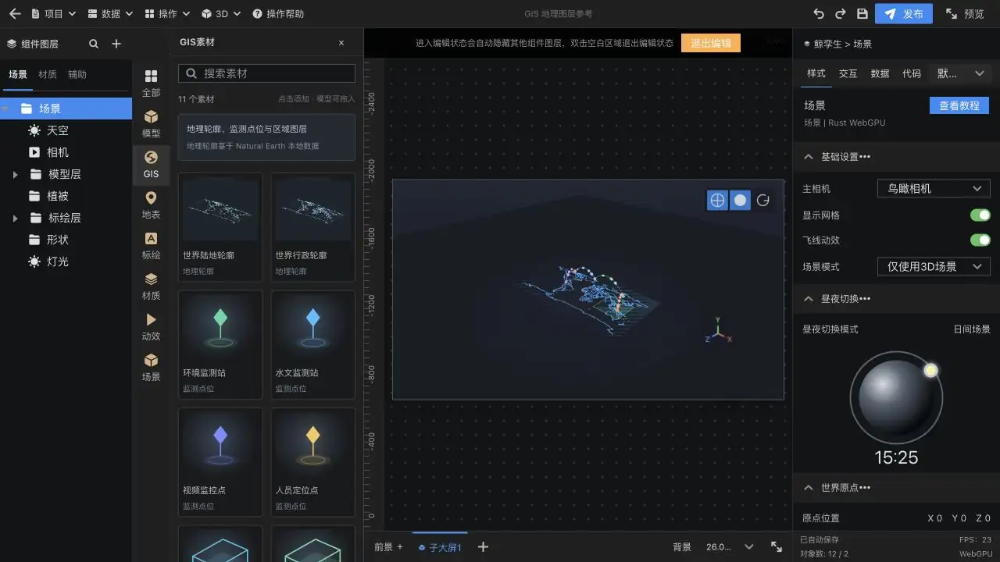

# 分类素材扩展验证

2026-10-31，本地开发工作区。

| 分类 | 素材数 | 内容和操作 |
| --- | ---: | --- |
| GIS | 11 | Natural Earth 陆地/行政轮廓、监测点、区域、空间连接 |
| 地表 | 20 | 17 个 Kenney 草地/步道/河道模型，以及 3 个道路设施 |
| 标绘 | 15 | 标记、区域围栏、飞线和工业管道 |
| 材质 | 12 | 颜色预设，套用到选中对象，保留模型原色板的明暗关系 |
| 动效 | 8 | 6 组粒子飞线与 2 组悬浮光柱 |
| 场景 | 7 | 园区、地表、GIS、城市、管道、车辆和楼层组合 |

另有 26 项模型/基础形状和 7 项辅助对象，共 106 个素材条目，复用 47 份实际网格资源。
Kenney 模型使用 CC0；Natural Earth 数据属于公有领域。GLB、GeoJSON、来源与授权保留在
`frontend/public/models/` 和 `frontend/public/gis/`。

本次检查：

- 21 项前端测试通过，包括重叠 ID 的场景插入、独立分组、整组撤销/重做，以及 GIS/地表项目持久化。
- 8 项 Rust 测试与格式检查通过，覆盖相机/拾取、47 份网格、全部 WGSL 与 storage 数组步长；更新了原先固定为 28 份模型的资源数量断言。
- 47 份网格的 DWM1 头、顶点数量、有限浮点数、三角面数量、PNG 预览及 GLB 源文件检查通过。
- TypeScript、Vite 生产构建和 Rust WASM 发布构建通过。
- 浏览器分别打开六个分类，确认素材数量、缩略图与操作说明。
- 添加 GIS 环境监测站，确认位置 `[-12, 5, -8]`；套用科技蓝后对象颜色变为 `#528EF1`，撤销后恢复。
- 场景插入创建独立分组；车辆组合使 GIS 示例从 12 个对象增至 18 个，GPU 模型实例从 2 增至 7；一次撤销恢复 12 个对象和 2 个模型实例。
- 地表样板保存为 24 个对象；GIS 示例保存为 12 个对象。两份示例在 Rust WebGPU 下实际渲染。
- 调整粒子大小和弧线透明度，并将粒子边缘改为递增 smoothstep 后取反；GIS 示例的点位、轮廓和流动粒子正常显示。

本地示例项目：

- 地表：`f18929d1-7708-4e6b-88b8-a29143111bc2`
- GIS：`5e760a27-6b04-49a9-a60d-6041eccc7c39`

项目数据位于当前浏览器 localStorage，可以通过项目菜单导出 JSON。
GIS 资源是本地地理轮廓示例；材质是颜色预设，完整 PBR、在线 GIS 流式瓦片和水体仿真仍属后续工作。

