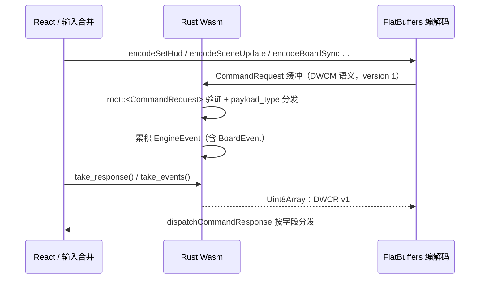

# 引擎与前端的全量 FlatBuffers 通信契约

更新：2026-11-02。

wasm↔前端的**结构化通信已全部二进制化**：3D 引擎、软件渲染回退（`SoftwareCanvas`）与看板（`BoardCanvas`）的命令输入、事件输出都不再经过 JSON。JSON 只存在于两类非边界位置：Rust 内部把 `JsonValue` 还原成 `serde_json::Value` 的实现细节，以及前端对网络 GeoJSON 源文件的一次 `JSON.parse`（源头本身就是 JSON）。

## 通信方向与载体

| 方向 | 载体 | 内容 |
| --- | --- | --- |
| 前端 → 引擎 | 每次调用一个 `CommandRequest` 缓冲（**无** identifier） | `set_mode` / `set_hud` / `set_environment` / `set_selections` / `sync_scene`（Engine）、`frame`（SoftwareCanvas）、`sync_scene` / `set_value` / `set_geojson` / `frame` / `snapshot`（BoardCanvas） |
| 引擎 → 前端 | `take_response()` / `take_events()` 排空一条 **size-prefixed** `CommandResponse` 队列（identifier `DWCR`） | 3D 引擎事件 + 看板交互事件（`EventPayload.BoardEvent` 追加成员） |
| 引擎 → 前端（同步返回） | 专用小缓冲 | `hit_test()` → `HitResult`（空缓冲=无命中）；`supported_kinds()` → `StringList` |
| 不走序列化 | 标量 / 字节 | `pointer_*` / `wheel` / `camera_view` / `set_lighting` / `set_image` / `register_mesh` / `set_selection` 等 |

高频鼠标移动继续使用数值参数及按帧合并；坐标查询等小型数值返回值继续使用现有数组接口。

### 坐标空间约定（view origin）

wasm 引擎内部所有坐标是 f32。为支持大坐标场景（如带 UTM 偏移的地理数据），引擎消费与产出的一切世界坐标都是**渲染原点相对坐标**：`sync_scene` 的实例位置、`TransformEvent` 回传的位置、`position_on_plane` / `screen_position` / `camera_view` / `camera_state` 的目标点。原点只平移 XZ（Y 是地面高度，保持绝对值），由前端在 [`engine/viewOrigin.ts`](../frontend/src/engine/viewOrigin.ts) 维护：scene worker 在 `openProject` / `loadScene` 时计算一次场景包围盒中心，前端在同步边界做平移，场景树与持久化数据始终保存世界坐标。原点相对坐标仍是 f32；原点本身的精度由 f64 保证。



## Wire 格式

唯一 schema：[`protocol/command_response.fbs`](../protocol/command_response.fbs)。编译器、Rust crate 与 npm 运行时统一使用 FlatBuffers **25.9.23**。

### 命令入（CommandRequest）

- 根表 `CommandRequest { protocol_version: ushort, payload: CommandPayload (required) }`；编码器显式写 `protocol_version = 1`，`0` 保留为无效。
- `CommandPayload` 是 union：`SetMode / SetHud / SetEnvironment / SetSelections / SceneUpdate / SoftwareFrame / BoardSync / SetValue / BoardClock / GeoJsonDocument`。
- 请求缓冲**不带文件标识**（单文件只能声明一个 identifier，已归 `DWCR`）。Rust 用 `flatbuffers::root::<CommandRequest>`（走 verifier）+ 版本检查 + **payload_type 匹配**保证安全：Engine / BoardCanvas / SoftwareCanvas 存在同名方法（如两处 `sync_scene`），缓冲串路由时会被 payload_type 校验拒绝，不会误读。
- 每个方法只接受自己的 payload 类型；`sync_scene` 解码失败上报 `Error` 事件，其余方法静默忽略。
- 语义约定：`SetEnvironment.daylight`/`fog_distance` 以 `0` 表示缺省（合法值域不含 0）；`RenderOptions.selected_id`/`background` 以空串表示缺省；`Instance.locked` 用 `= null` 标量可选；TS 编码器总是写全必填字段（`id`/`kind`/`pos`/`size`/`color` 在 schema 中 required）。

### 事件出（CommandResponse，DWCR v1）

非空队列采用标准 **size-prefixed FlatBuffer**：

| 字段 | 约定 |
| --- | --- |
| 前 4 字节 | 小端 `u32`，等于余下数据的字节数 |
| 文件标识 | `DWCR`，位于完整响应的字节 8–11 |
| 根表 | `CommandResponse` |
| `protocol_version` | 显式写入 `1`；`0` 表示未指定 |
| `events` | `Event` 有序向量，union `EventPayload` 分发 |

`EventPayload` 成员：`PickEvent / TransformEvent / StatsEvent / HudEvent / ErrorEvent / ProbeEvent / BoardEvent`。`BoardEvent` 是看板（egui canvas）交互事件，追加在 union 末尾（旧读取端自动跳过未知成员）。空帧返回零长度 `Uint8Array`，不发空包。

`BoardEvent { id, kind, action: BoardAction, value: JsonValue }`：`BoardAction` 枚举 `Change / Focus / Open / Media / Upload / ColorPicker`；`value` 用泛型 `JsonValue` 承载任意控件取值。

### 泛型 JsonValue（无 schema 载荷）

看板节点 `data`、`set_value` 输入、`BoardEvent.value` 本质是无 schema 的 JSON，走递归 union：

```
JsonValue { payload: JsonPayload }  // JsonNull / JsonBool / JsonNumber / JsonString / JsonArray / JsonObject
JsonNumber { value: double, integer: bool }  // integer 标记还原 3 而非 3.0（表格等字符串化场景）
JsonObject { entries: [JsonEntry { key, value }] }  // 保留插入顺序
```

Rust 侧在边界处一次性还原成 `serde_json::Value`（`protocol::json_value_from_wire`），看板内部所有消费点不变；编码方向对称（`protocol::json_value_to_wire`）。

### GeoJSON

`set_geojson` 接收 `GeoJsonDocument`：前端对网络返回的 GeoJSON `JSON.parse` 一次后压成 `features: [{ polygons: [Polygon { rings: [Ring { points: [float] }] }], name, name_zh }]`（Polygon 一个 polygon，MultiPolygon 多个；points 为扁平 lon,lat 对）。Rust 侧还原成既有消费形状，规模约束不变（≤300 要素、≤20000 点/环）。

## 读取 / 拷贝 / 生命周期

ByteBuffer 直接引用传入的 `Uint8Array`；访问器按偏移读取，从不 `unpack()`。仍保留两次字节拷贝（Rust `finished_data().to_vec()` 与 wasm-bindgen 返回值的 `.slice()`），"zero-copy" 指二进制字段读取，不指整条 JS/wasm 管线；builder 与事件 Vec 在引擎内复用。前端读取器检查长度前缀、文件标识（仅响应）、根偏移与版本，不是通用 verifier；Rust 侧 `flatbuffers::root` / `size_prefixed_root_as_command_response` 都走 verifier，业务代码不使用 unchecked 入口。

## 生成与兼容规则

Rust 和 TypeScript 生成代码已经包含在源码中，普通安装和构建不需要 flatc。修改 schema 时，从 [FlatBuffers 官方 v25.9.23 发布页](https://github.com/google/flatbuffers/releases/tag/v25.9.23) 获取匹配的 flatc（macOS x64 资产名 `MacIntel.flatc.binary.zip`；本仓库工具副本放在 `tools/flatc`，已 gitignore），在 `frontend` 运行：

```bash
FLATC=/path/to/flatc pnpm generate:protocol
FLATC=/path/to/flatc pnpm check:protocol
pnpm build:engine
```

`FLATC` 未设置时使用 PATH 中的 `flatc`。脚本检查编译器版本，并为生成的 Rust unsafe 块补齐 `SAFETY` 说明、显式化返回值的省略生命周期，再统一格式化。业务编码器使用安全 API；生成代码单独隔离，lint 排除不扩展到手写代码。

新增兼容字段应放到表末尾并保持可选；union 成员只能追加，不能重排或复用编号。v1 读取器会跳过未来追加的未知 union 类型，保持后续已知事件可读。破坏现有语义的改动须升级协议版本，并同时部署 JS 绑定、Wasm 二进制和前端读取器（三者同仓原子发布）。

## 验证

`frontend/src/engine/commands.ts` 是命令编码与小缓冲解码的唯一入口；`commandResponse.ts` 是 DWCR 队列的唯一读取器。回归命令：

```bash
cargo test -p native-probe --tests                      # Rust 协议 fixture（字节级）+ 请求解码
cargo clippy -p data-wind-engine -p protocol-smoke --target wasm32-unknown-unknown
pnpm test                                               # vitest：dispatch / 编码器往返 / JsonValue 边界
pnpm test:protocol:wasm                                 # TS 编码 → wasm 解码；看板事件 → TS 分发；memory grow
pnpm test:board:wasm                                    # 真实 wasm：79 类组件、地图、IME、PNG 像素
pnpm build:engine                                       # 重新生成 wasm 与 d.ts（portable + parallel）
```

跨语言 fixture（Rust 产出、两端比对）：`frontend/src/tests/fixtures/command_response_v1.bin`（引擎事件）与 `board_events_v1.bin`（看板事件），由 `cargo run -p native-probe --example command_response_fixture` 再生成。追加 schema 成员不改变旧编码字节，旧 fixture 必须保持字节不变。

记录于 2026-11-02 的验证结果：Rust 15+ 测试全绿（含 6 个协议测试）、vitest 151 全绿、两个 wasm 冒烟脚本全绿、`check:protocol` 一致。
